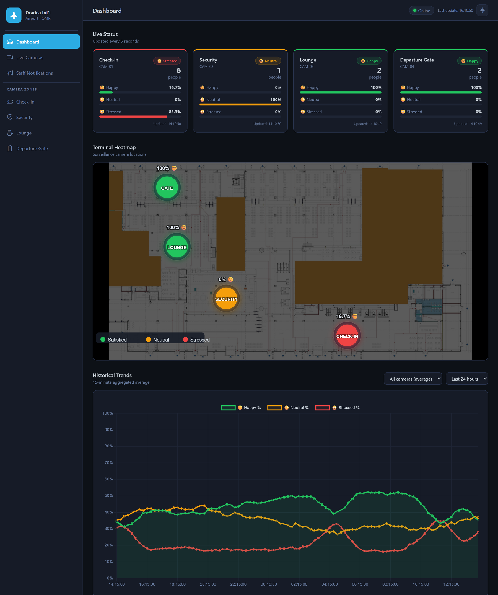
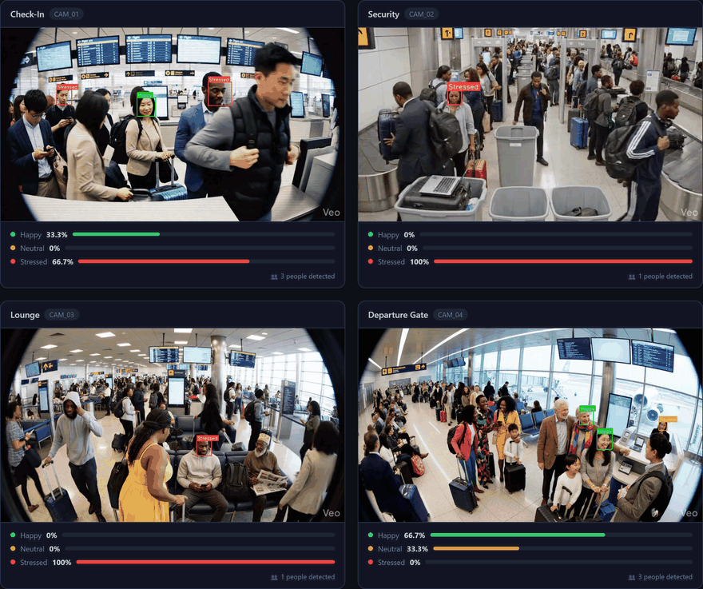
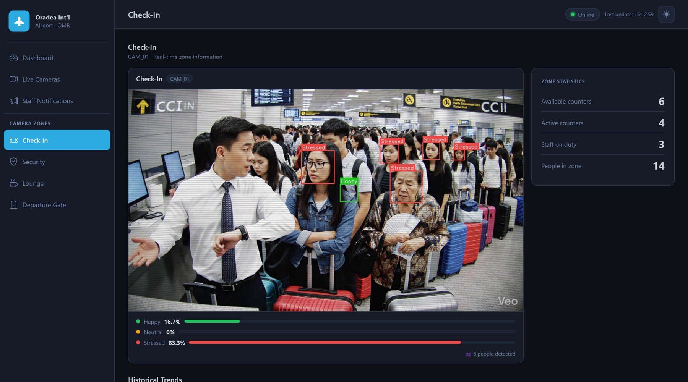
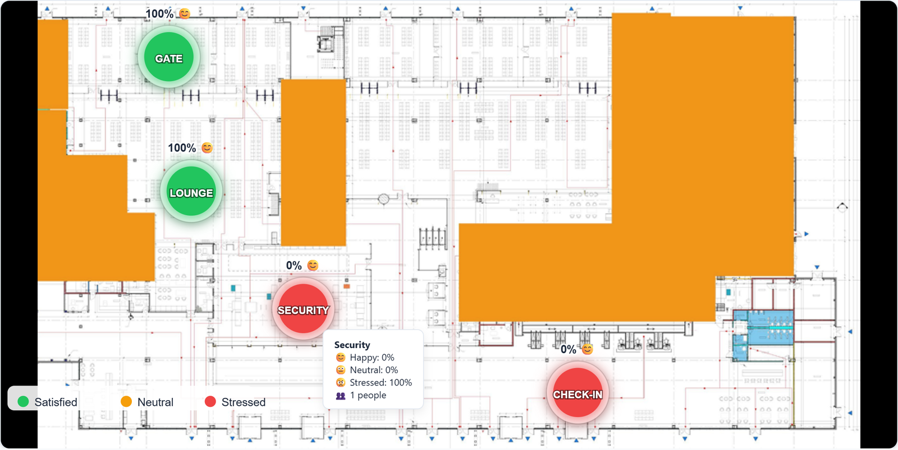
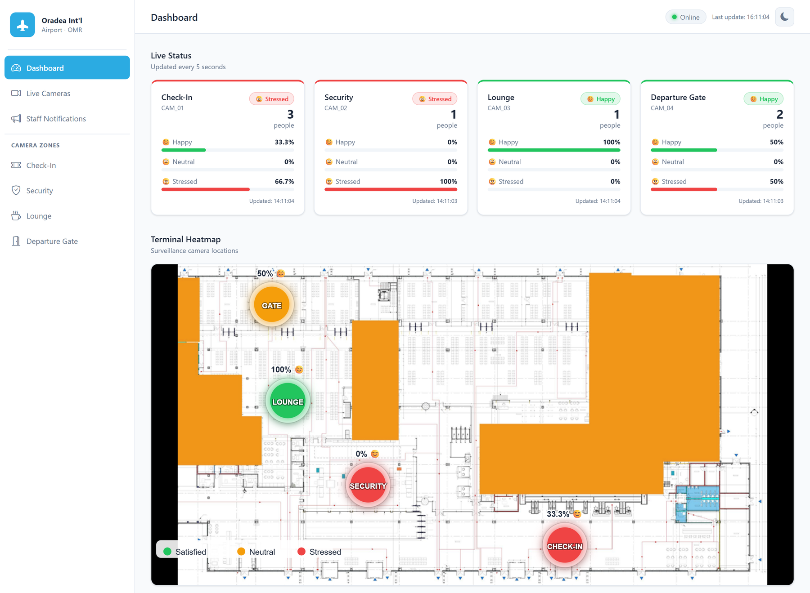
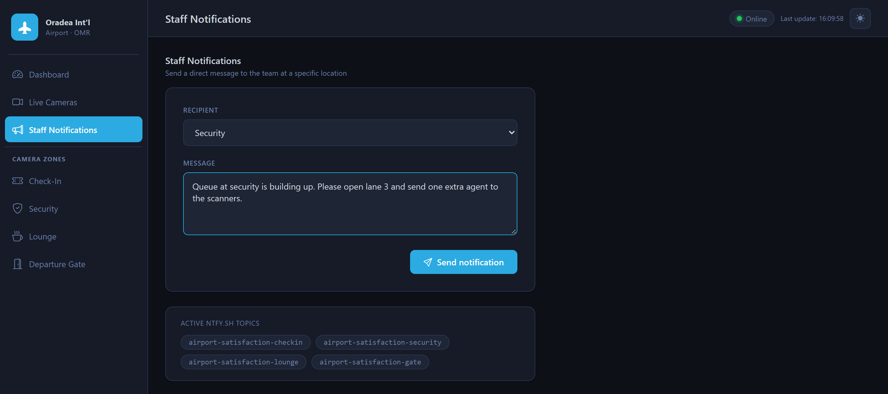
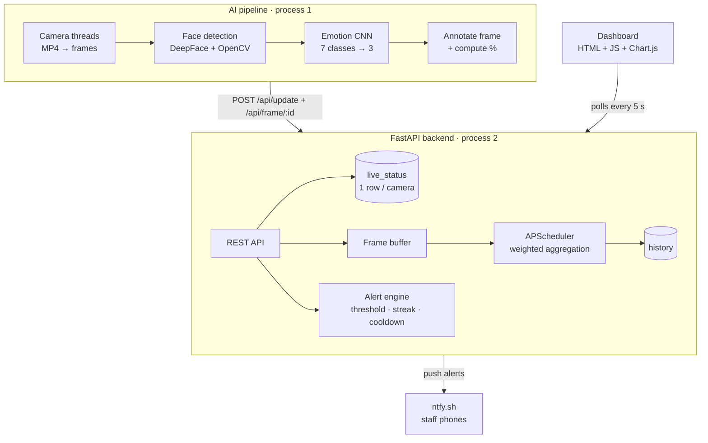

<div align="center">

# ✈️ Airport Sentiment

**Real-time passenger emotion analytics for airport terminals, powered by computer vision.**

Turns CCTV feeds into a live satisfaction dashboard: it detects faces, classifies emotions, maps stress hot-spots on the terminal floor plan, and pushes alerts to staff phones before a queue turns into a complaint.


</div>

<p align="center">
  
</p>

## Why

Airports usually measure passenger satisfaction with surveys, days after the experience. This project measures it **while it happens**. Every camera zone (check-in, security, lounge, gate) gets a live mood score, so operations staff can see where stress is building and react: open another security lane, send an agent to a check-in queue, or announce a delay update at the gate.

## Features

- 🎥 **Multi-camera AI pipeline.** Each camera runs in its own thread. Faces are detected in every sampled frame and classified as *happy*, *neutral* or *stressed*.
- 📊 **Live dashboard.** Per-zone emotion breakdown and head-count, refreshed every 5 s.
- 🗺️ **Terminal heatmap.** Camera markers on the real floor plan, coloured by a satisfaction score (`happy − stressed`), with hover details.
- 📈 **Historical trends.** Person-weighted aggregates stored over time, filterable by zone and time range (1 h / 6 h / 24 h).
- 🖼️ **Annotated live feeds.** Bounding boxes and emotion labels drawn on every processed frame.
- 🔔 **Smart alerts.** A push notification (via [ntfy.sh](https://ntfy.sh)) fires when a zone stays above a stress threshold for several consecutive frames, with a per-camera cooldown to avoid spam.
- 📣 **Staff messaging.** Supervisors send a message from the dashboard straight to the phones of a specific zone's team.
- 🌗 **Light and dark theme** with no flash on load. No build step: plain HTML, CSS and JS.

## See it in action

<p align="center">
  
  <br><sub><b>Live Cameras:</b> every processed frame is annotated by the pipeline, and the bars underneath come from the same frame.</sub>
</p>

<table>
  <tr>
    <td width="50%" valign="top">
      
      <br><sub><b>Zone view:</b> camera feed, emotion split and operational context for one area.</sub>
    </td>
    <td width="50%" valign="top">
      
      <br><sub><b>Terminal heatmap:</b> zones coloured by satisfaction score, with details on hover.</sub>
    </td>
  </tr>
  <tr>
    <td width="50%" valign="top">
      
      <br><sub><b>Light theme:</b> the same dashboard, with your choice persisted per user.</sub>
    </td>
    <td width="50%" valign="top">
      
      <br><sub><b>Staff notifications:</b> push a message to one zone's team.</sub>
    </td>
  </tr>
</table>

<sub>Screenshots are from a local run on the bundled sample clips. Live cards, heatmap and camera feeds show real pipeline output; the 24-hour trend chart was pre-filled with sample data for the demo.</sub>

## How it works

Two independent Python processes communicate over HTTP. Heavy CV inference stays isolated from the API, and the dashboard is a static page that polls the API.



1. **Capture.** `CameraSimulator` threads loop through each zone's video files and sample one frame per `FRAME_INTERVAL_SECONDS`.
2. **Detect.** DeepFace (OpenCV backend) finds every face and crops it with padding.
3. **Classify.** The DeepFace emotion model predicts 7 emotions, which are collapsed into **happy / neutral / stressed** (`angry`, `fear`, `disgust`, `sad` → stressed).
4. **Publish.** The pipeline posts per-frame percentages and an annotated JPEG to the API.
5. **Store and alert.** The API upserts the live row, buffers the frame for aggregation, and checks alert rules.
6. **Visualise.** The dashboard polls `/api/live`, `/api/history` and `/api/frame/:id`.

### Engineering highlights

| Design choice | Details |
|---|---|
| **Hot / cold data split** | `live_status` holds exactly one upserted row per camera, so dashboard reads stay constant-time. `history` stores only aggregated snapshots. |
| **Person-weighted aggregation** | Snapshots weight each frame by its face count, so a single detected face can't skew a zone's average. |
| **Debounced alerting** | An alert needs the threshold **and** N consecutive frames **and** an expired per-camera cooldown. One misclassified frame never pages anyone. |
| **Privacy by design** | Only aggregate percentages are persisted. No face crops or identities are stored, and annotated frames live in memory only (latest frame per camera). |
| **Data retention** | A scheduled job purges history older than `DATA_RETENTION_DAYS` every night at 03:00. |
| **Zero-build frontend** | Vanilla JS, theming through CSS custom properties, an inline anti-flash theme script, and Chart.js from a CDN. |

## Tech stack

| Layer | Technologies |
|---|---|
| Computer vision | DeepFace (TensorFlow / Keras emotion model), OpenCV |
| Backend | FastAPI, Uvicorn, Pydantic, SQLAlchemy 2, APScheduler, httpx |
| Database | MySQL (PyMySQL driver) |
| Frontend | HTML5, CSS3, vanilla JavaScript, Chart.js, SVG, Bootstrap Icons |
| Notifications | ntfy.sh push notifications |

## API

Interactive Swagger docs are available at `http://localhost:8000/docs` once the backend is running.

| Method | Endpoint | Description |
|---|---|---|
| `POST` | `/api/update` | Pipeline → per-frame emotion percentages and person count |
| `POST` | `/api/frame/{camera_id}` | Pipeline → latest annotated frame (base64 JPEG) |
| `GET` | `/api/live` | Latest status for every camera |
| `GET` | `/api/history?camera_id=&hours=24` | Aggregated history, optionally per camera |
| `GET` | `/api/frame/{camera_id}` | Latest annotated frame as `image/jpeg` |
| `GET` | `/api/cameras` | Configured cameras |
| `POST` | `/api/notify` | Send a message to a zone's staff (`checkin`, `security`, `lounge`, `gate`) |

## Getting started

**Prerequisites:** Python 3 and a running MySQL server.

```bash
git clone https://github.com/AvramPaul/airport-sentiment.git
cd airport-sentiment/airport-satisfaction
pip install -r requirements.txt
```

Create the database (tables are created automatically when the backend starts):

```sql
CREATE DATABASE airport_satisfaction;
```

Set your MySQL credentials (`DB_USER`, `DB_PASSWORD`) in `config.py`, then start each part in its own terminal:

```bash
python -m backend.main                            # API → http://localhost:8000
python -m ai_pipeline.pipeline                    # AI pipeline (first run downloads model weights)
python -m http.server 5500 --directory frontend   # Dashboard → http://localhost:5500
```

### Configuration

Everything lives in [`config.py`](airport-satisfaction/config.py):

| Setting | Default | Purpose |
|---|---|---|
| `CAMERAS` | 4 zones | Camera ID → zone name and the video files it loops through |
| `FRAME_INTERVAL_SECONDS` | `1` | How often each camera samples a frame |
| `EMOTION_MAP` | 7 → 3 | How raw emotions map to happy / neutral / stressed |
| `AGGREGATION_INTERVAL_MINUTES` | `3` | How often history snapshots are written |
| `DATA_RETENTION_DAYS` | `30` | History older than this is purged nightly |
| `ALERT_SAD_THRESHOLD` | `90.0` | Stressed % that counts toward an alert |
| `ALERT_CONSECUTIVE_FRAMES` | `3` | Consecutive frames above the threshold needed to fire |
| `ALERT_COOLDOWN_MINUTES` | `10` | Minimum gap between alerts for the same camera |
| `NTFY_BASE_URL` / `NTFY_TOPIC` | ntfy.sh | Where automatic stress alerts are pushed |

To get notifications on your phone, install the [ntfy app](https://ntfy.sh) and subscribe to your alert topic. Staff messages go to one topic per zone: `airport-satisfaction-checkin`, `-security`, `-lounge` and `-gate`.

## Project structure

```
airport-satisfaction/
├── ai_pipeline/
│   ├── frame_extractor.py     # threaded camera simulators (MP4 → frames)
│   ├── face_detector.py       # face detection + cropping
│   ├── emotion_classifier.py  # emotion model, 7 → 3 class mapping
│   └── pipeline.py            # orchestration, frame annotation, POST to API
├── backend/
│   ├── main.py                # FastAPI app and endpoints
│   ├── models.py              # live_status and history tables
│   ├── aggregator.py          # scheduled weighted aggregation + retention purge
│   ├── alerts.py              # threshold / streak / cooldown alert engine
│   └── database.py            # SQLAlchemy engine and session handling
├── frontend/
│   ├── index.html             # dashboard, live cameras, zones, notifications
│   ├── app.js                 # polling, charts, heatmap, navigation
│   ├── style.css              # light and dark design tokens
│   └── misc/Airport_map.png   # terminal floor plan
├── videos/                    # sample camera footage (AI-generated)
├── config.py
└── requirements.txt
```

## Roadmap

- [ ] Live RTSP / IP camera input in place of the MP4 simulators
- [ ] WebSocket push in place of polling
- [ ] GPU batching of face crops for higher throughput
- [ ] Docker Compose setup (MySQL + API + pipeline + dashboard)
- [ ] Dashboard authentication and role-based access

---

<div align="center">

Built by **Paul Avram** · [GitHub](https://github.com/AvramPaul)

</div>
